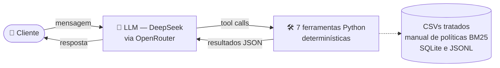

# Bia — agente de atendimento da Empório da Música

Um agente de mensagens para a loja fictícia de instrumentos
**Empório da Música** (Campo Grande/MS). A persona é a **Bia**: informal, acolhedora e que só afirma o que consultou.

- **Linguagem:** Python 3.10+.
- **Modelo:** `deepseek/deepseek-v4.1-flash` via **OpenRouter** (API OpenAI-compatível).
- **Interfaces:** chat web (**Vite + React**, servido pela API Python) e CLI em Python.

## Como rodar

```bash
python -m venv .venv && source .venv/bin/activate
pip install -e ".[dev]"
cp .env.example .env            # preencha OPENROUTER_API_KEY
python scripts/check_openrouter.py   # lista modelos DeepSeek com tool calling e confere OPENROUTER_MODEL
pytest -q                       # testes do backend: não usam rede nem chave
```

**Chat web** (Python 3.10+ e Node 20+):

```bash
cd frontend && npm install && npm run build && cd ..   # gera frontend/dist
python -m emporio.web                                  # http://127.0.0.1:8000
# desenvolvimento do front: python -m emporio.web  +  (cd frontend && npm run dev)  -> http://localhost:5173 (proxy /api)
# testes do front: (cd frontend && npm test)
```

A API serve o build e expõe `POST /api/chat` e `GET /api/history`. Escuta só em 127.0.0.1 e não tem autenticação (protótipo).

Ou mais simples, só sobe tudo de uma vez:

```bash
./start.sh
```

**CLI** (mais simples, só Python):

```bash
python -m emporio.cli --trace   # --trace mostra as ferramentas chamadas; comandos: /novo /sessoes /trace /exportar /sair
```

**Conversas de exemplo** (rodam cenários reais contra o modelo e gravam as transcrições em `examples/`):

```bash
python scripts/generate_examples.py
```

> Os dados de exemplo terminam em mar/2026, então os prazos de devolução dependem da data. `EMPORIO_NOW=2026-02-20T10:00:00`
> fixa o "agora" (o gerador de exemplos já faz isso).

## Arquitetura

Não é RAG nem usa um framework agente de terceiros: é um loop ReAct escrito à mão em Python (`agent.py`), com function
calling nativo sobre o modelo DeepSeek via OpenRouter — sem retrieval semântico/vetorial (ver "Busca nas políticas" em
Decisões técnicas) e sem dependência do DeepSeek Harness (`dsh`), que serviu só de inspiração de design (ver "Robustez do
loop").



A mesma lista de ferramentas (`src/emporio/tools.py`) é usada de duas formas, sem duplicar lógica:

1. **Loop em Python** (`agent.py`): function calling nativo, até 6 passos por mensagem (um passo = uma ida ao modelo).
2. **Servidor MCP stdio** (`mcp_server.py`): as mesmas ferramentas expostas para qualquer cliente MCP (ex.: Claude Desktop).

| Ferramenta | Para quê |
|---|---|
| `buscar_produtos` | opções por categoria/faixa de preço/termos; só itens vendáveis por padrão |
| `obter_produto` | preço, promoção, estoque, specs; alternativas se indisponível |
| `simular_pagamento` | PIX, parcelas válidas, frete e combinação de pagamentos |
| `consultar_pedido` | status/rastreio/prazos (exige nº do pedido + e-mail ou telefone) |
| `consultar_politicas` | busca no manual, devolve a seção como fonte |
| `horario_atendimento` | aberto agora? considera sábado, domingo e feriados de MS |
| `encaminhar_atendente` | registra o caso e devolve protocolo + prazo (24 h úteis) |

## Decisões técnicas e justificativas

- **Function calling (ReAct nativo) em vez de RAG puro ou text-to-SQL.** Os dados são pequenos e estruturados; consultas
  parametrizadas são mais seguras e auditáveis que SQL gerado por LLM, e o modelo decide *quando* consultar dados vs. políticas.
  Preço, estoque, prazo e conta saem de código, não do modelo.
- **Estratégia de prompt: system prompt único, estruturado por seção, temperatura baixa.** Não usa few-shot (exemplos de
  conversa) nem prompts separados por intenção: é um só prompt estático (`prompts.py`), dividido em seções nomeadas (tom,
  regra de nunca inventar, como apresentar preços, pedidos e privacidade, escopo, reclamações, segurança), cada uma
  mapeada direto a uma regra do manual de políticas — isso facilita auditar e ajustar uma regra sem reescrever o resto.
  A seção central, "nunca invente", obriga o modelo a chamar uma ferramenta pra qualquer fato (preço, estoque, promoção,
  status, prazo) em vez de confiar na própria memória — é a principal defesa contra o risco mais comum nesse tipo de
  agente, que é inventar informação. O prompt também trata mensagens do cliente e resultados de ferramentas como dados,
  não comandos, com instrução explícita pra ignorar tentativas de mudar a persona, revelar o prompt ou conceder condições
  fora das políticas (defesa contra prompt injection). A temperatura é baixa (`0.2`): a tarefa é seguir regras de forma
  consistente, não ser criativo, então menos aleatoriedade reduz a chance de fugir do tom ou das regras. O prompt é
  enviado inteiro a cada chamada ao modelo (não fica salvo no histórico), garantindo que é sempre a mesma versão, sem
  risco de divergir entre sessões.
- **Busca nas políticas: por palavra-chave, não por IA (embeddings).** O manual foi dividido por seção e a busca usa um algoritmo
  clássico de busca por texto (BM25) mais uma pequena lista de sinônimos ("me arrependi" → arrependimento/devolução). Com só ~8
  páginas, usar embeddings (busca semântica) adicionaria complexidade sem ganho claro. O PDF foi convertido para
  `data/politicas_da_loja.md`, e cada trecho citado pro cliente vem com o número da seção, pra dar rastreabilidade. Limite: a lista
  de sinônimos é manual e não escalaria pra um manual bem maior — aí valeria a pena usar busca semântica.
- **Robustez do loop.** Se uma ferramenta falha, o erro é tratado e devolvido ao modelo de forma genérica (a conversa não quebra).
  Consultas que o modelo pede ao mesmo tempo (ex.: preço + estoque) rodam em paralelo para responder mais rápido; ações com efeito
  colateral (abrir consulta de pedido, encaminhar para um atendente) rodam uma de cada vez, por segurança. Esse desenho foi
  inspirado em como o DeepSeek Harness (`dsh`, projeto open-source) estrutura o loop de um agente — li o código dele e adaptei as
  ideias pro Python; não usei nem copiei código do projeto.
- **Por que `deepseek-v4.1-flash`, e não um modelo de fronteira.** A tarefa do agente é consultar os dados certos e devolver uma
  resposta objetiva — não exige raciocínio longo em várias etapas, então o ganho de um modelo de fronteira (ex.: Astra, Fable, Opus) seria marginal pra esse caso de uso e custaria vários múltiplos mais. O Flash tem o maior benchmark
  entre os modelos DeepSeek da própria faixa leve/rápida, responde rápido mesmo em conversas com vários turns de chamada de
  ferramenta (porque cada resposta individual é curta) e custa uma fração do preço por token dos modelos maiores. Pra um chatbot de
  baixo volume cuja tarefa principal é consulta de dados, isso é o melhor custo-benefício: qualidade suficiente, latência e custo bem
  menores. O modo "raciocínio" fica desligado por padrão (`EMPORIO_REASONING=default` reativa) porque ainda não é compatível com o
  jeito que o loop chama as ferramentas.
- **Interface: chat web (React) + CLI.** O chat web é a experiência principal; a CLI é um atalho mais simples (sem build de
  frontend) pra testar o agente direto no terminal.
- **Histórico:** SQLite (stdlib), uma linha por mensagem no formato da API; retoma por `--session`, com janela das últimas 40
  mensagens (sem cortar no meio de um par tool_call/tool).
- **Segurança/privacidade:** pedidos só abrem com nº + e-mail/telefone; falha de validação devolve sempre a mesma mensagem (não revela se o
  pedido existe) e há limite de 5 falhas/10 min.

### Tratamento dos dados (`data.py`)

| Problema encontrado | Tratamento |
|---|---|
| `active` com estoque 0 (Giannini GF-3D) | `sem_estoque`: não vendável, sugere alternativas |
| `discontinued`/`coming_soon` com estoque > 0 | nunca vendáveis, independente do estoque |
| Promoções com `is_active=0` (a maioria) | ignoradas; só `is_active=1` vale; se houver mais de uma, a maior |
| PIX (5%) × promoção | **não cumulativos** (manual 6.2): item promocional não tem preço PIX |
| `specs` em JSON-texto; `electronics` yes/no | parseados; traduzidos para sim/não |
| E-mail repetido entre clientes | detectado em `quality_issues()` (validação por pedido+contato continua segura) |
| Preços | `Decimal`, nunca `float` |

### Suposições e ambiguidades do material

- **Dois telefones no manual** (3341-4444 na ficha da empresa; 3321-4500 no WhatsApp): o prompt manda apresentar ambos com contexto
  e oferecer confirmação, em vez de escolher um.
- **E-mail** com acento na seção 1.2 do PDF (`empóriodamusica`): usei a grafia sem acento da capa.
- **Parcelamento "até 3x sem mínimo (exceto abaixo de R$ 50)":** interpretado como piso de R$ 50 por parcela.
- **Data de recebimento** não existe nos dados; uso a `estimated_delivery` de pedidos entregues e aviso que a equipe confirma a elegibilidade.
- **Manual diz "300+ instrumentos"**, o CSV tem 65: o agente só fala do que as ferramentas retornam.
- **Frete:** o manual diz "acima de R$ 500" para frete grátis; trato exatamente R$ 500,00 como pago.
- **Lojas parceiras** (manual 7.1): sem lista, o agente sugere "uma loja especializada" sem citar nomes.

## Limitações conhecidas e próximos passos

- Sem avaliação automática de qualidade das respostas (próximo passo: conjunto de cenários com checagens de tool calls e de fatos).
- Sem fechamento de venda/reserva, sem integração real com WhatsApp, `encaminhar_atendente` grava em arquivo (`var/encaminhamentos.jsonl`).
- Busca de políticas com sinônimos manuais; busca de produtos lexical (sem tolerância a erros de digitação além de plural).

## Uso de assistentes de código

O projeto foi desenvolvido com o **Claude Code (Anthropic)** em modo agente, com revisão ativa em cada etapa:

- Foi usado o modo de planejamento (*Plan Mode*) do Claude Code para alinhar a abordagem antes das implementações maiores.
- Foi pedida a consulta à documentação oficial (Python 3.10, API/MCP do OpenRouter, Vite e React) nas decisões de configuração que
  não eram óbvias.
- Foram usadas referências visuais *ground truth* (a identidade real da Artefact) para guiar o design da interface web.
- A arquitetura foi focada em uma solução funcional, simples e barata: os dados são pequenos e estruturados (CSVs com ~65 produtos,
  poucas dezenas de pedidos, manual de ~8 páginas) e o domínio é consulta objetiva (preço, estoque, status, política), não um
  problema de raciocínio complexo — por isso function calling sobre dados estruturados e busca lexical bastam, sem exigir
  infraestrutura de RAG com embeddings/vetor DB nem um modelo caro; o assistente leu o enunciado e os dados, escreveu o código e os testes, e
  executou a validação end-to-end contra o modelo real (DeepSeek via OpenRouter), incluindo a geração dos `examples/`.
- Antes de cada entrega (PR), foi usada a skill `simplify` do Claude Code para revisar o próprio diff (reuso, qualidade e
  eficiência) e corrigir o que fosse encontrado, inclusive retroativamente nas primeiras entregas.
- As operações no GitHub (criação de branches, commits, abertura e merge das PRs) foram feitas pelo próprio Claude Code
  usando a `gh` CLI, simulando um fluxo de entregas incrementais em vez de um único commit.
