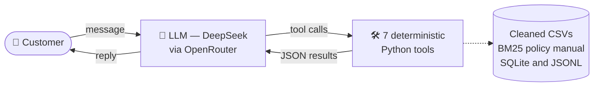

# Bia — Empório da Música customer service agent

A messaging agent for the fictional musical instrument store
**Empório da Música** (Campo Grande/MS, Brazil). The persona is **Bia**: informal, welcoming, and who only states what she checked.

- **Language:** Python 3.10+.
- **Model:** `deepseek/deepseek-v4.1-flash` via **OpenRouter** (OpenAI-compatible API).
- **Interfaces:** web chat (**Vite + React**, served by the Python API) and a Python CLI.

## How to run

```bash
python -m venv .venv && source .venv/bin/activate
pip install -e ".[dev]"
cp .env.example .env            # fill in OPENROUTER_API_KEY
python scripts/check_openrouter.py   # lists DeepSeek models with tool calling and checks OPENROUTER_MODEL
pytest -q                       # backend tests: no network or API key needed
```

**Web chat** (Python 3.10+ and Node 20+):

```bash
cd frontend && npm install && npm run build && cd ..   # builds frontend/dist
python -m emporio.web                                  # http://127.0.0.1:8000
# frontend dev mode: python -m emporio.web  +  (cd frontend && npm run dev)  -> http://localhost:5173 (proxies /api)
# frontend tests: (cd frontend && npm test)
```

The API serves the build and exposes `POST /api/chat` and `GET /api/history`. It only listens on 127.0.0.1 and has no authentication (prototype).

Or simpler, bring everything up at once:

```bash
./start.sh
```

**CLI** (simplest, Python only):

```bash
python -m emporio.cli --trace   # --trace shows the tools called; commands: /novo /sessoes /trace /exportar /sair
```

**Example conversations** (run real scenarios against the model and record the transcripts in `examples/`):

```bash
python scripts/generate_examples.py
```

> The sample data ends in Mar/2026, so return deadlines depend on the current date. `EMPORIO_NOW=2026-02-20T10:00:00`
> pins "now" (the example generator already does this).

## Architecture

Not RAG, and not built on a third-party agent framework: it's a hand-written ReAct loop in Python (`agent.py`), with
native function calling over the DeepSeek model via OpenRouter — no semantic/vector retrieval (see "Policy search" under
Technical decisions) and no dependency on the DeepSeek Harness (`dsh`), which only served as a design inspiration (see
"Loop robustness").



The same tool list (`src/emporio/tools.py`) is used in two ways, without duplicating logic:

1. **Python loop** (`agent.py`): native function calling, up to 6 steps per message (one step = one round trip to the model).
2. **MCP stdio server** (`mcp_server.py`): the same tools exposed to any MCP client (e.g., Claude Desktop).

| Tool | What it's for |
|---|---|
| `buscar_produtos` | options by category/price range/terms; only sellable items by default |
| `obter_produto` | price, promotion, stock, specs; alternatives if unavailable |
| `simular_pagamento` | PIX, valid installments, shipping and combined payments |
| `consultar_pedido` | status/tracking/deadlines (requires order number + email or phone) |
| `consultar_politicas` | searches the manual, returns the section as the source |
| `horario_atendimento` | open now? accounts for Saturday, Sunday and MS state holidays |
| `encaminhar_atendente` | logs the case and returns a protocol number + SLA (24 business hours) |

## Technical decisions and justifications

- **Function calling (native ReAct) instead of pure RAG or text-to-SQL.** The data is small and structured; parameterized
  queries are safer and more auditable than LLM-generated SQL, and the model decides *when* to query data vs. policies.
  Price, stock, deadlines and totals come from code, not from the model.
- **Prompt strategy: a single system prompt, structured by section, low temperature.** No few-shot (example conversations)
  and no prompts split by intent: it's one static prompt (`prompts.py`), divided into named sections (tone, the
  never-invent rule, how to present prices, orders and privacy, scope, complaints, security), each mapped directly to a
  rule in the policy manual — this makes it easy to audit and tweak one rule without rewriting the rest. The central
  section, "never invent", forces the model to call a tool for any fact (price, stock, promotion, status, deadline)
  instead of relying on its own memory — this is the main defense against the most common risk in this kind of agent:
  making up information. The prompt also treats customer messages and tool results as data, not commands, with explicit
  instructions to ignore attempts to change the persona, reveal the prompt, or grant conditions outside the policies
  (prompt injection defense). Temperature is low (`0.2`): the task is to follow rules consistently, not to be creative,
  so less randomness reduces the chance of drifting from the tone or the rules. The whole prompt is sent on every call to
  the model (it is never saved to the conversation history), guaranteeing it's always the same version, with no risk of
  diverging between sessions.
- **Policy search: keyword-based, not AI-based (embeddings).** The manual was split by section, and the search uses a
  classic text-search algorithm (BM25) plus a small synonym list ("I regret it" → regret/return). With only ~8 pages,
  using embeddings (semantic search) would add complexity without a clear benefit. The PDF was converted to
  `data/politicas_da_loja.md`, and every excerpt quoted to the customer comes with the section number, for traceability.
  Limitation: the synonym list is manual and wouldn't scale to a much larger manual — that's where semantic search would
  be worth it.
- **Loop robustness.** If a tool fails, the error is handled and returned to the model in a generic way (the conversation
  doesn't break). Queries the model requests at the same time (e.g., price + stock) run in parallel to respond faster;
  actions with side effects (opening an order lookup, escalating to a human agent) run one at a time, for safety. This
  design was inspired by how the DeepSeek Harness (`dsh`, an open-source project) structures an agent loop — I read its
  code and adapted the ideas into Python; I did not use or copy any code from that project.
- **Why `deepseek-v4.1-flash`, and not a frontier model.** The agent's task is to look up the right data and return an
  objective answer — it doesn't require long multi-step reasoning, so the gain from a frontier model (e.g., Astra,
  Fable, Opus) would be marginal for this use case and cost several multiples more. Flash has the best benchmark among
  DeepSeek's own lightweight/fast tier, responds quickly even in conversations with several tool-call turns (because
  each individual response is short), and costs a fraction of the per-token price of larger models. For a low-volume
  chatbot whose main job is data lookup, this is the best cost-benefit: enough quality, much lower latency and cost. The
  "reasoning" mode is off by default (`EMPORIO_REASONING=default` re-enables it) because it isn't compatible yet with the
  way the loop calls tools.
- **Interface: web chat (React) + CLI.** The web chat is the main experience; the CLI is a simpler shortcut (no frontend
  build needed) to test the agent directly in the terminal.
- **History:** SQLite (stdlib), one row per message in the API's own format; resumable via `--session`, with a window of
  the last 40 messages (never cut in the middle of a tool_call/tool pair).
- **Security/privacy:** orders only open with an order number + email/phone; a failed validation always returns the same
  message (doesn't reveal whether the order exists), and there's a limit of 5 failures per 10 minutes.

### Data handling (`data.py`)

| Problem found | Handling |
|---|---|
| `active` with 0 stock (Giannini GF-3D) | `sem_estoque`: not sellable, suggests alternatives |
| `discontinued`/`coming_soon` with stock > 0 | never sellable, regardless of stock |
| Promotions with `is_active=0` (most of them) | ignored; only `is_active=1` counts; if more than one, the highest |
| PIX discount (5%) × promotion | **not stackable** (manual 6.2): promotional items don't get the PIX price |
| `specs` as JSON-text; `electronics` yes/no | parsed; translated to yes/no |
| Duplicate email across customers | detected in `quality_issues()` (order+contact validation stays safe) |
| Prices | `Decimal`, never `float` |

### Assumptions and ambiguities in the source material

- **Two phone numbers in the manual** (3341-4444 on the company info page; 3321-4500 on WhatsApp): the prompt instructs
  presenting both with context and offering confirmation, instead of picking one.
- **Email with an accent** in section 1.2 of the PDF (`empóriodamusica`): I used the unaccented spelling from the cover
  page.
- **Installments "up to 3x with no minimum (except below R$ 50)":** interpreted as a R$ 50 floor per installment.
- **Delivery date** doesn't exist in the data; I use the `estimated_delivery` of delivered orders and tell the customer
  the team will confirm eligibility.
- **The manual says "300+ instruments"**, the CSV has 65: the agent only talks about what the tools return.
- **Shipping:** the manual says "above R$ 500" for free shipping; I treat exactly R$ 500.00 as qualifying.
- **Partner stores** (manual 7.1): no list provided, so the agent suggests "a specialized store" without naming any.

## Known limitations and next steps

- No automated quality evaluation of responses (next step: a set of scenarios with tool-call and fact checks).
- No order/reservation checkout, no real WhatsApp integration, `encaminhar_atendente` just logs to a file
  (`var/encaminhamentos.jsonl`); with more time, I would integrate with a real CRM/support queue.
- Policy search uses manual synonyms; product search is lexical (no typo tolerance beyond plurals); with more time, I
  would replace both with semantic search (embeddings), since the manual synonym list doesn't scale.

## Use of coding assistants

This project was built with **Claude Code (Anthropic)** in agent mode, with active review at every step:

- Claude Code's planning mode (*Plan Mode*) was used to align on the approach before larger implementations.
- Official documentation (Python 3.10, OpenRouter's API/MCP, Vite and React) was consulted for non-obvious configuration
  decisions.
- *Ground truth* visual references (Artefact's actual visual identity) were used to guide the web interface design.
- The architecture was kept focused on a functional, simple and cheap solution: the data is small and structured
  (CSVs with ~65 products, a few dozen orders, an ~8-page manual) and the domain is objective lookup (price, stock,
  status, policy), not a complex reasoning problem — so function calling over structured data plus lexical search is
  enough, without needing RAG infrastructure with embeddings/a vector DB or an expensive model; the assistant read the
  brief and the data, wrote the code and the tests, and ran end-to-end validation against the real model (DeepSeek via
  OpenRouter), including generating the `examples/`.
- Before every delivery (PR), Claude Code's `simplify` skill was used to review its own diff (reuse, quality and
  efficiency) and fix anything found, including retroactively on the earliest deliveries.
- GitHub operations (creating branches, commits, opening and merging PRs) were done by Claude Code itself using the
  `gh` CLI, simulating an incremental-delivery workflow instead of a single commit.
